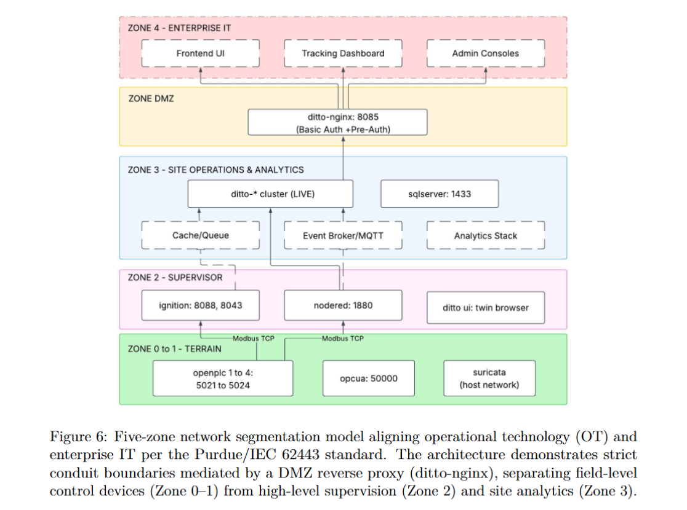

# ControlTwin - ICS Digital-Twin Security Lab


A reproducible, forensically-instrumented sandbox for pre-deployment security assessment of Industrial Control Systems (ICS). ControlTwin combines containerized OpenPLC field controllers, an IEC 62443-zone-aligned network topology and an Eclipse Ditto digital-twin layer to stage MITRE ATT&CK for ICS techniques against live water-treatment and conveyor processes, measuring their physical and forensic consequences empirically rather than theoretically.

Developed as part of a research project funded by the National Cybersecurity Consortium (NCC) / Consortium national de cybersécurité (CNC) at Université de Sherbrooke, in partnership with Centris Technologies, Neverhack and Productique Québec.

Licensed under **Apache License 2.0** -- see [`LICENSE`](./LICENSE).

## Table of Contents

- [Architecture](#architecture)
- [Repository Structure](#repository-structure)
- [Quick Start](#quick-start-full-containerized-environment)
- [Python Dependencies](#python-dependencies)
- [Attack Scenarios](#attack-scenarios)
- [Reproducing Results](#reproducing-results)
- [Forensic-Readiness Experiment](#forensic-readiness-experiment)
- [Portable Standalone Demo](#portable-standalone-demo)
- [Data Availability Note](#data-availability-note)
- [Security Note](#security-note)
- [Documentation](#documentation)
- [Citing This Work](#citing-this-work)
- [Contributors](#contributors)

## Architecture



## Repository Structure

```
├── config/                          Field-layer and digital-twin configuration
│   ├── CuveRegulationAvancee.st     Structured Text: tank regulation logic
│   ├── ditto-nginx.conf             Reverse proxy config for Eclipse Ditto
│   ├── ditto.htpasswd               Credential hash placeholder (not a live secret)
│   ├── eclipse-ditto-thing.json     Digital-twin thing definition
│   ├── flows.json                   Node-RED flow export
│   ├── ignition-tags.json           Ignition SCADA tag configuration
│   ├── kibana-index.ndjson          Kibana index pattern export
│   ├── openplc-modbus-map.csv       Full Modbus register map
│   └── sqlserver-schema.sql         Historian database schema
│
├── scripts/                         Attack, baseline, and detection scripts
│   ├── attack_command_injection.py
│   ├── attack_sensor_blinding_v3.py
│   ├── attack_process_fatigue.py
│   ├── attack_modbus_flooding.py
│   ├── dos_phase4_attack.py         Concurrent flood + safety-monitor experiment
│   ├── safety_monitor.py            Selective-logging DoS forensic monitor
│   ├── detection_impact_realtime_final.py   Command/telemetry discordance evaluator
│   ├── scan_timing.py               Baseline scan-cycle timing measurement
│   ├── reset_cuve_cmds.py           Resets HMI command coils between runs
│   ├── generate_baseline_simple.py  Baseline traffic generator (pump ON/OFF cycling)
│   ├── prepare_baseline_normal.py   Baseline preparation utility
│   ├── prepare_baseline_target_63.py Baseline preparation utility (target level 63%)
│   ├── plot_openplc.py              Traffic/timing visualization
│   ├── plot_normal_modbus.py        Traffic/timing visualization
│   ├── write_coil_attack_bridge.py  Generic parameterized coil-write attack script
│   └── archive/                     Superseded script iterations, kept for reference
│
├── datasets/                        Raw experimental data
│   └── thesis-results/              Data captured for this thesis (Chapter 5)
│       └── prior-experiments/       Earlier team baseline/attack captures
│
├── pcaps/                           Packet captures
│   └── thesis-results/              Captures used for Chapter 5 traffic analysis
│       └── prior-experiments/       Earlier team packet captures
│
├── docs/                            Written results per attack (RESULTS_*.md)
│   ├── images/                      Architecture diagrams and figures
│   ├── RESULTS_command_injection.md
│   ├── RESULTS_sensor_blinding.md
│   ├── RESULTS_sensor_spoofing.md
│   ├── RESULTS_process_fatigue.md
│   ├── RESULTS_modbus_flooding.md
│   ├── RESULTS_setpoint_modification.md
│   ├── RESULTS_unauthenticated_api.md
│   └── RESULTS_dos_forensic_experiment.md
│
├── replit_simulation/ics-water-tank-scada/   Portable, dependency-light standalone reimplementation
│   └── src/                         Optional VMware bridge gateway (gateway.js)
│
├── docker-compose.yml                Full 17-service orchestration manifest
├── requirements.txt                  Python dependencies for scripts/
├── .env.example                      Template for required environment variables
├── LICENSE
└── README.md                         This file
```

## Quick Start (Full Containerized Environment)

Requires Docker and Docker Compose.

```bash
git clone https://github.com/kowshikaa333/ICS-Digital-Twin-Security-Lab.git
cd ICS-Digital-Twin-Security-Lab
cp .env.example .env        # then edit .env with your own SQL Server password
docker compose up -d
```

Bring-up follows a four-stage sequence: field layer (OpenPLC) -> digital twin (Eclipse Ditto cluster) -> supervision (Node-RED, Ignition) -> historian (SQL Server). Once healthy:

| Service | URL |
|---|---|
| OpenPLC (tank controller) | http://localhost:8081 |
| Node-RED | http://localhost:1880 |
| Ignition SCADA | http://localhost:8088 |
| Eclipse Ditto (via reverse proxy) | http://localhost:8085 |
| Kibana | http://localhost:5601 |

## Python Dependencies

The attack, baseline-generation, and analysis scripts in `scripts/` require Python 3.10+ and the packages listed in [`requirements.txt`](./requirements.txt):

```bash
pip install -r requirements.txt
```

This installs `pymodbus` (Modbus TCP client, used by every attack script), `pandas` and `matplotlib` (traffic-capture analysis and visualization), `scipy` (baseline statistical comparison -- Shapiro-Wilk normality testing, Mann-Whitney U testing), and `elasticsearch` (the Python client used to query command/telemetry indices for discordance detection).

## Attack Scenarios

Seven staged attacks, mapped to MITRE ATT&CK for ICS techniques are implemented in `scripts/`. Each attack's real, measured results are documented in the corresponding `docs/RESULTS_*.md` file.

| Attack | Technique | Result Summary | Details |
|---|---|---|---|
| Command Injection | T0855 | 53%->95% in ~85s; discordance detector structurally blind (bypasses command-logging layer) | [RESULTS](docs/RESULTS_command_injection.md) |
| Sensor Blinding | T0821 | 41-point divergence between true and reported state, undetected for full attack duration | [RESULTS](docs/RESULTS_sensor_blinding.md) |
| Process Fatigue | T0802 | 3.28 Hz actuator toggling invisible to threshold-based alarms | [RESULTS](docs/RESULTS_process_fatigue.md) |
| Modbus Flooding | T0814 | +28.3% mean latency, +213.4% jitter (Mann-Whitney U, p=0.000477) | [RESULTS](docs/RESULTS_modbus_flooding.md) |
| Setpoint Modification | T0836 | Register-level write fails silently; engineering-access-level edit succeeds | [RESULTS](docs/RESULTS_setpoint_modification.md) |
| Sensor Spoofing | T0856 | Partial detection gap; redundant alarm logic limits full effectiveness | [RESULTS](docs/RESULTS_sensor_spoofing.md) |
| Unauthenticated API Access | T0871 | Full flow logic + internal network topology disclosed, zero authentication | [RESULTS](docs/RESULTS_unauthenticated_api.md) |

## Reproducing Results

Every result above can be regenerated from a clean environment:

1. Bring up the full stack (`docker compose up -d`) and confirm all services report healthy.
2. Establish a baseline before running any attack:
   ```bash
   python scripts/generate_baseline_simple.py
   python scripts/scan_timing.py
   ```
3. Reset command state to avoid contamination from a previous run:
   ```bash
   python scripts/reset_cuve_cmds.py
   ```
4. Run the target attack, e.g.:
   ```bash
   python scripts/attack_command_injection.py
   ```
5. Evaluate the resulting discordance score:
   ```bash
   python scripts/detection_impact_realtime_final.py
   ```
6. Compare against baseline traffic/timing:
   ```bash
   python scripts/plot_openplc.py
   ```

The exact parameters, thresholds and expected output for each specific attack are documented in that attack's `docs/RESULTS_*.md` file.

## Forensic-Readiness Experiment

A five-phase Denial-of-Service forensic-readiness experiment (`scripts/dos_phase4_attack.py`, `scripts/safety_monitor.py`) demonstrates that a monitoring process sharing a Modbus connection with an attacker can itself become the first casualty of a DoS attack, evidence-capture completeness collapsed to approximately 2% under concurrent connection contention. Root cause: this specific OpenPLC instance's Modbus TCP server reliably serves exactly one concurrent connection but fails almost immediately upon a second. Full results in [`docs/RESULTS_dos_forensic_experiment.md`](docs/RESULTS_dos_forensic_experiment.md).

## Portable Standalone Demo

`replit_simulation/ics-water-tank-scada/` is a single-file Node.js reimplementation of the tank control logic requiring no Docker or container orchestration exposes Modbus TCP, an embedded MQTT broker, a REST API, and a WebSocket from one process. Behaviorally equivalent to the deployed Structured Text program (identical setpoint, deadband, fill/drain rates, and safety cutoffs), with one deliberate addition: a directly-triggerable emergency-stop coil.

```bash
cd replit_simulation/ics-water-tank-scada
npm install
node server.js
```

Then open http://localhost:3000.

## Data Availability Note

`datasets/prior-experiments/` and `pcaps/prior-experiments/` contain earlier baseline and attack captures from the broader NCC/CNC-funded research team, retained for continuity but not the basis for the results reported in the accompanying thesis. All figures cited in the thesis's Chapter 5 are drawn exclusively from `datasets/thesis-results/` and `pcaps/thesis-results/`.

## Security Note

This environment is a deliberately vulnerable research testbed and is **not intended for production use**. Default credentials, unauthenticated Modbus TCP, and disabled TLS are used throughout by design, to faithfully reproduce real-world ICS attack surfaces. Do not expose any service in this repository to an untrusted network.

## Documentation

Full methodology, architecture rationale, and experimental protocol are documented in the accompanying master's thesis, *Cybersecurity Assessment Framework for Pre-Deployment of ICS Digital Twins Using ControlTwin* (Université de Sherbrooke, 2025-2026).

<!-- ## Citing This Work

If this repository supports your research, please cite the accompanying thesis:

```bibtex
@mastersthesis{karthikeyan2026controltwin,
  author = {Karthikeyan, Kowshikaa},
  title  = {Cybersecurity Assessment Framework for Pre-Deployment of {ICS} Digital Twins Using {ControlTwin}},
  school = {Universit\'e de Sherbrooke},
  year   = {2026}
}
```

## Contributors

Developed collaboratively as part of an NCC/CNC-funded research team. Individual thesis contributions -- experimental protocol design, attack execution, and forensic-readiness evaluation -- are detailed in the thesis's Statement of Individual Contribution.  -->
